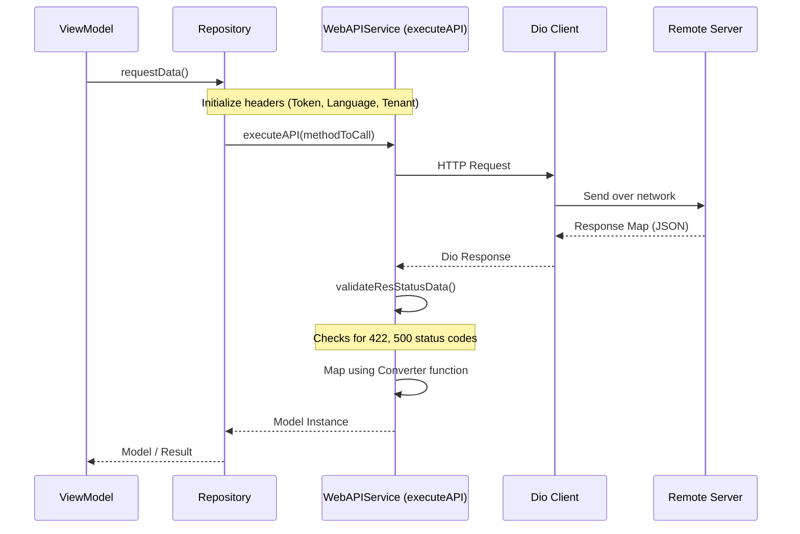

# API Integration Standard

This document details the standardized network communications architecture using `WebAPIService`, exception catching, and token-session management.

## Network Architecture & Execution Flow

All network operations are executed via a unified service client: **`WebAPIService`** (a Dio singleton found in `lib/services/web_api_services.dart`).



## Request Header Initialization

Before firing network operations, headers must be initialized inside the repository or network client by invoking helper loaders sequentially. This is handled via:

- `initTokenToHeader()`: Fetches the stored token using `getTokenFromSharedPref()` and appends it to headers: `Authorization: Bearer <token>`.
- `initLangPrefToHeader()`: Resolves the current language code using `getLanguageSharedPref()` and appends it to header key: `lang`.
- `initTenantPrefToHeader()`: Resolves tenant configuration and appends it to headers under `tenant`.

## API Request Execution Standard (`executeAPI`)

All endpoints must be executed via repository methods defined as extensions on `WebAPIService` that call `executeAPI` to leverage built-in response parsing, error mapping, and automatic loading handlers.

**MANDATORY Header Chaining Pattern**: You must dynamically chain all required header operations (e.g. `initTokenToHeader`, `initLangPrefToHeader`, `initTenantPrefToHeader`) sequentially using `.then()` inside the `methodToCall` Future. This guarantees that parameters are safely committed to the shared Dio request options object before the HTTP call launches:

```dart
extension MyFeatureRepo on WebAPIService {
  Future<MyModel> fetchMyData() {
    return executeAPI<MyModel>(
      methodToCall: initTokenToHeader().then(
        (value) => initLangPrefToHeader().then(
          (value) => dio.get(urlMyEndpoint),
        ),
      ),
      converter: (responseMap) => MyModel.fromJson(responseMap as Map<String, dynamic>),
      onSuccess: (value) => debugPrint("Successfully retrieved MyModel"),
      onError: (appError) => debugPrint("Failed with error: ${appError.message}"),
    );
  }
}
```

## ViewModel Repository Invocation Standard (`.setProgress(this)`)

**CRITICAL MANDATE**: All repository methods must be invoked inside ViewModels by calling the extension method on `WebAPIService()`, handling errors via `onError: (msg) => showToast(msg)`, updating state in `onSuccess`, and chaining `.setProgress(this)`.

This ensures unified loading state management across the app via `MixinProgressProvider`:

```dart
// --- Favorite Locations State ---
List<FavoriteLocationItem> _favoriteLocations = [];
List<FavoriteLocationItem> get favoriteLocations => _favoriteLocations;

/// Fetches favorite locations for the passenger.
Future<void> fetchFavoriteLocations() async {
  WebAPIService()
      .getFavoriteLocations(
        onError: (msg) {
          showToast(msg);
        },
        onSuccess: (result) {
          _favoriteLocations = result.data ?? [];
        },
      )
      .setProgress(this);
}
```

### Key Principles:
1. **Direct `WebAPIService()` Invocation**: No repository class instances are constructed. Methods are extension methods called directly on `WebAPIService()`.
2. **Error Handling**: Pass `onError: (msg) { showToast(msg); }` (or custom user notification).
3. **Success Handling**: Update internal ViewModel state in `onSuccess: (result) { ... }`.
4. **Loading State Binding (`.setProgress(this)`)**: Always append `.setProgress(this)` at the end of the Future chain. `setProgress` is an extension on `Future<T>` (defined in `lib/utils/extensions.dart`) that binds to `MixinProgressProvider` on the `ViewModel`, automatically managing `isLoading` state (sets `isLoading = true` when started, and `false` upon completion or error).

## Paginated API Integration Standard (`fetchListData`)

**CRITICAL MANDATE**: For any paginated list integration, ViewModels extending `ViewModel` (from `lib/providers/view_model.dart`) **must use `fetchListData<T>()`** instead of implementing custom page counter state or ad-hoc pagination flags.

### Base `ViewModel` Pagination Properties:
- `page`: Internal page index (starts at `1`, auto-incremented by 1 when the loaded page size equals `limit`).
- `canLoadMore`: Returns `(!_isAllCompleted) && (!super.isLoading)`.
- `reset()`: Resets `page` back to `1` and clears the completion state (`_isAllCompleted = false`).

### Standard Pattern:
```dart
class MyListViewModel extends ViewModel {
  final WebAPIService _api = WebAPIService();
  final List<MyItemModel> _items = [];
  List<MyItemModel> get items => List.unmodifiable(_items);

  static const int _limit = 10;
  bool loadFailed = false;

  @override
  bool get canLoadMore => super.canLoadMore;

  Future<void> load({bool refresh = false}) async {
    if (refresh) {
      reset();
      _items.clear();
    }
    if (!canLoadMore && !refresh) return;

    loadFailed = false;
    final currentPage = page;

    fetchListData<MyItemModel>(
      limit: _limit,
      apiService: () async {
        final response = await _api.getMyListItems(
          page: currentPage,
          perPage: _limit,
          onError: (msg) {
            loadFailed = true;
            showToast(msg);
            notifyListeners();
          },
        );
        return response.data ?? <MyItemModel>[];
      },
      onShowError: (msg, [asToast]) {
        loadFailed = true;
        showToast(msg);
        notifyListeners();
      },
      onSuccess: (models) {
        _items.addAll(models);
        notifyListeners();
      },
    );
  }
}
```

## Exception Parsing & Session Invalidation

This project implements centralized error mapping logic inside the network mixin (`lib/services/_mixins_api.dart`):

### 1. Dio Errors (`onDioError`)
- Handles timeouts, connection errors, and cancellation errors.
- **Connection Issues**: Auto-redirects to `/ConnectionFailedScreen` inside `onDioError` when an active internet dropout is caught.
- **Bad Responses**:
  - Checks if the response map holds authentication or token failures (`"Message": "Unauthenticated"` or `"message": "Unauthenticated"`).
  - Triggers an `APIException` with `EnumAPIExceptions.invalidToken` which immediately logs the user out.

### 2. Status Validation (`validateResStatusData`)
- Parses incoming JSON and extracts specific API-level status codes:
  - **`500` Server Errors**: Translates message payload into a readable warning.
  - **`422` Validation Failures**: Triggers validation exceptions showing the message block.

### 3. Session Invalidation (`onInvalidToken`)
- When an expired or corrupted session is validated:
  - Invokes `signOutUser()` which clears the database and sets configuration properties back to defaults.
  - Clears all cached user data stored in `SharedPreferences` (`SpHelper.clearAll()`).
  - Forces navigation back to the login page via named routing, stripping any active navigation stack to prevent unauthorized back-scrolling:
    ```dart
    AppConfig.navKey.currentState.pushNamedAndRemoveUntil(
      LoginScreen.routeName,
      (route) => false,
    );
    ```
